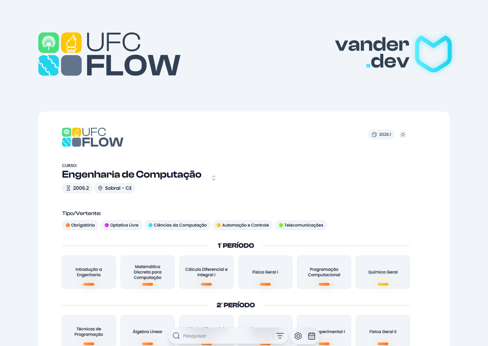

<h1 align="center">
  
</h1>

<h3 align="center">
  🌊 UFC Flow
</h3>

<p align="center">Acompanhe seu fluxo acadêmico de forma interativa, simule sua grade e visualize seus pré-requisitos na UFC.</p>

## ✅ Sobre o projeto

O **UFC Flow** é uma plataforma web interativa desenvolvida para facilitar a visualização de fluxogramas e matrizes curriculares dos cursos da **Universidade Federal do Ceará (UFC)**. Ela auxilia os discentes a planejarem seu progresso acadêmico, entenderem a malha de pré-requisitos e correquisitos de forma intuitiva, além de simular e montar grades horárias para os semestres seguintes.

O projeto foi construído utilizando tecnologias modernas de desenvolvimento frontend e foi estruturado sob rigorosos princípios de Engenharia de Software e Gerenciamento de Configuração de Software (GCS).

---

## ⚙️ Tecnologias

Tecnologias utilizadas no desenvolvimento da plataforma:

<div align="center"> 
  <div style="display: inline_block"><br>
    
    
    
    
  </div>
</div>

---

## ✨ Funcionalidades Principais

- **Visualização Interativa de Fluxogramas**: Renderização dinâmica e interativa das matrizes curriculares usando `@xyflow/react` (React Flow).
- **Simulação de Grade**: Planejamento do próximo semestre com controle automático de pré-requisitos e validação de conflitos de horários.
- **Detalhamento de Disciplinas**: Janelas informativas com código, ementa (quando disponível), carga horária e requisitos.
- **Histórico e Progresso Escolar**: Marcação visual de disciplinas concluídas, em andamento ou planejadas.
- **Modo Escuro & Claro (Dark Mode/Light Mode)**: Suporte completo e dinâmico a temas visuais com `next-themes` e Tailwind CSS.
- **Web Scraping Integrado**: Integração com dados públicos da universidade para extração automatizada de grades e turmas.

---

## 🗂️ Estrutura do monorepo

O UFC Flow é um monorepo gerenciado com **pnpm workspaces** e **Turborepo**:

```text
apps/
  web/            # Front-end Next.js (aplicação atual)
  api/            # API NestJS (em construção)
  extension/      # Extensão que extrai a estrutura curricular do SIGAA (em construção)
packages/
  contracts/      # Schemas Zod e tipos compartilhados entre web, api e extensão
  academic-core/  # Regras acadêmicas puras (pré-requisitos, equivalências, progresso)
```

Versões de dependências compartilhadas (TypeScript, Zod, `@types/node`) ficam no `catalog` do [pnpm-workspace.yaml](pnpm-workspace.yaml) e são referenciadas com `"catalog:"` nos `package.json`.

---

## 📦 Como instalar o pnpm

O **pnpm** é o gerenciador de pacotes adotado no UFC Flow, e a versão exata fica fixada no campo `packageManager` do [package.json](package.json). A forma recomendada de instalá-lo é pelo **Corepack**, que já vem com o Node.js:

```bash
corepack enable
```

Ao rodar qualquer comando `pnpm` dentro do projeto, o Corepack baixa e usa automaticamente a versão definida no repositório.

> Sem Corepack, instale globalmente com `npm install -g pnpm`.

Para conferir a instalação:

```bash
pnpm --version
```

---

## 🚀 Rodando o projeto

Siga as instruções abaixo para executar o projeto localmente.

### 1. Pré‑requisitos

- **Git** instalado em sua máquina.
- **Node.js** 22 ou superior.
- **pnpm** (veja a seção [Como instalar o pnpm](#-como-instalar-o-pnpm) acima).

---

### 2. Clonar o repositório

Abra o seu terminal (Bash no Linux ou PowerShell/Git Bash no Windows) e execute:

```bash
git clone https://github.com/vander-furtuna/ufc-flow-front.git
cd ufc-flow-front
```

---

### 3. Configurar as variáveis de ambiente

As variáveis do front-end ficam em `apps/web`. Copie o modelo [apps/web/.env.example](apps/web/.env.example) para criar o arquivo local `apps/web/.env.local`:

#### 🐧 Linux:

```bash
cp apps/web/.env.example apps/web/.env.local
```

#### 🪟 Windows:

```powershell
copy apps\web\.env.example apps\web\.env.local
```

Abra o arquivo `apps/web/.env.local` e configure os valores necessários. Exemplo básico:

```env
NEXT_PUBLIC_CURRENT_YEAR=2026
NEXT_PUBLIC_CURRENT_SEMESTER=1
NEXT_PUBLIC_SITE_URL=http://localhost:3000
```

> 💡 **Nota**: O arquivo `.env.local` é ignorado pelo Git (conforme definido no [.gitignore](.gitignore)) para proteger suas credenciais e configurações locais.

---

### 4. Instalar as dependências

Na raiz do repositório:

```bash
pnpm install
```

---

### 5. Execução em Modo de Desenvolvimento

Para rodar o front-end com hot-reload (recarregamento automático):

```bash
pnpm dev:web
```

`pnpm dev` sobe todos os apps que tiverem script `dev`. Para rodar um comando em um pacote específico, use o filtro do pnpm, por exemplo `pnpm --filter @ufc-flow/web <script>`.

Acesse [http://localhost:3000](http://localhost:3000) no seu navegador para visualizar o UFC Flow em funcionamento.

---

### 6. Build e Execução em Produção

1. Gerar a build otimizada de todos os pacotes:
   ```bash
   pnpm build
   ```
2. Iniciar o servidor de produção do front-end:
   ```bash
   pnpm --filter @ufc-flow/web start
   ```

Por padrão, a aplicação de produção estará disponível em [http://localhost:3000](http://localhost:3000).

---

## 🛠️ Qualidade de Código & CI (Integração Contínua)

O repositório possui fluxos de validação de qualidade de código automatizados via GitHub Actions (definidos em [.github/workflows/ci.yml](.github/workflows/ci.yml)). As tarefas são orquestradas pelo Turborepo, que roda cada uma em todos os pacotes e reaproveita resultados em cache. Antes de enviar qualquer alteração, é altamente recomendado rodar localmente:

1. **Linting (Linter)**: Corrige e avisa sobre desvios nos padrões de estilo de código:
   ```bash
   pnpm lint
   ```
2. **Typecheck (TypeScript)**: Valida os tipos estáticos de todos os pacotes:
   ```bash
   pnpm typecheck
   ```
3. **Build local**: Verifica se o processo de compilação encerra com sucesso:
   ```bash
   pnpm build
   ```

---

## 📄 Gerenciamento de Configuração & Controle de Mudanças

Este projeto segue formalidades rígidas de GCS, documentadas no [PLANO_GERENCIAMENTO_CONFIGURACAO.md](PLANO_GERENCIAMENTO_CONFIGURACAO.md).

- **Commits**: Seguem a especificação de **Conventional Commits** (ex: `feat(agenda): adiciona popup de detalhes`).
- **Branches**: Adota o GitFlow simplificado, onde toda mudança entra via Pull Request (PR) na branch `develop` antes de ser congelada e enviada para a branch `master` sob uma tag versionada.
- **Itens de Configuração (ICs)**: Mapeados detalhadamente no documento [CONFIGURATION_ITEMS.md](CONFIGURATION_ITEMS.md).

---

Desenvolvido com 💙 para a comunidade acadêmica da **Universidade Federal do Ceará**.
