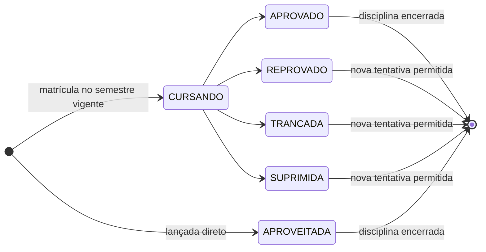

# UFC Flow — Modelagem v2

> Cópia versionada do documento [UFC Flow — Modelagem v2](https://claude.ai/artifact/UMzzHykJMZDD9gwt7Mdi7K) (revisão 28, exportada em 31/10/2026). **Este arquivo é a fonte de verdade dentro do repositório.** Mudanças de modelagem são feitas aqui, num PR, junto com o código que as implementa. Autor: Vanderlei Furtuna.
>
> Divergências entre este texto e o estado atual do repositório estão listadas em [estado-atual.md](estado-atual.md).

## Visão geral e escopo

A v2 do UFC Flow troca os dados estáticos do front (`src/data/courses.ts`) por uma API NestJS + PostgreSQL (Drizzle). Ela adiciona contas de usuário, histórico acadêmico, agendas sincronizadas, hub do curso, fórum e avaliação de disciplinas. A plataforma continua utilizável sem login: grade, turmas e agenda local seguem abertas.

**Entra na v2**

- Catálogo acadêmico no banco: cursos, estruturas curriculares (ECs), disciplinas, vertentes, requisitos e equivalências.
- Turmas coletadas pelo backend, com IDs estáveis.
- Usuários, papéis (aluno, moderador, admin) e solicitação de moderação.
- Histórico do aluno, horas complementares e progresso de integralização.
- Agendas: locais para anônimos, sincronizadas para logados.
- Hub do curso (posts e links), fórum estilo X e avaliação quantitativa de disciplinas.
- Imagens armazenadas na própria VM.
- Área de edição de grades (as funções do course-maker) dentro do UFC Flow, num monorepo com API e extensão.

**Continua como está**

- Cardápio do RU e Calendário Acadêmico: seguem como route handlers do Next com cache no IndexedDB. Não fazem parte da modelagem.

**Fica para depois**

- Tudo que depende de SMTP: verificação de e-mail, recuperação de senha por e-mail, notificações por e-mail.
- Backup do banco e dos arquivos para fora da VM.

## Registro de decisões

Cada linha é uma decisão já tomada e onde ela aparece na modelagem. Mudar uma decisão exige revisar a seção indicada.

| #   | Tema                     | Decisão                                                                                       | Consequência na modelagem                                                           |
| --- | ------------------------ | --------------------------------------------------------------------------------------------- | ----------------------------------------------------------------------------------- |
| D1  | Turmas                   | O backend faz o scraping do SIGAA e guarda as turmas no Postgres                              | IDs estáveis; agenda referencia `class_sections.id` (seção Turmas e agendas)        |
| D2  | Agenda sem login         | Anônimo usa IndexedDB; logado sincroniza; importação das agendas locais no primeiro login     | `schedules.id` gerado no cliente (UUID) para importação idempotente                 |
| D3  | EC vigente               | Definida pela Pró-Reitoria de Graduação, nem sempre a mais recente                            | Flag explícita `is_current`, marcada manualmente, uma por curso                     |
| D4  | EC publicada             | Só muda o que não prejudica registros ligados a ela                                           | Regra de edição "monotônica" + log de auditoria                                     |
| D5  | Equivalências            | Globais                                                                                       | Ficam na disciplina (`subject_equivalences`), não na EC                             |
| D6  | Fórum                    | Assíncrono, no modelo do X/Twitter                                                            | Mensagens com respostas encadeadas, curtidas, feed paginado por cursor              |
| D7  | Menções                  | Digitar `@` abre um popover de busca por nome ou código da disciplina                         | Token `@CÓDIGO` no texto + tabela de menções gravada na escrita + endpoint de busca |
| D8  | Repositórios             | Monorepo com web, API e extensão; course-maker absorvido pelo web                             | `apps/web`, `apps/api`, `apps/extension`, `packages/*`                              |
| D9  | ORM                      | Drizzle                                                                                       | Schema em `apps/api/src/infrastructure/database/schema`                             |
| D10 | RU e Calendário          | Permanecem como estão                                                                         | Fora do banco                                                                       |
| L1  | Situação da disciplina   | Cursando, aprovado, reprovado, trancada, suprimida, aproveitada                               | Enum `record_status` + regras de nova tentativa                                     |
| L2  | EC do aluno              | A matrícula aponta para a EC que o aluno segue                                                | `student_enrollments.curriculum_id`                                                 |
| L3  | Moderação                | Usuário solicita, admin aprova                                                                | `moderator_requests`                                                                |
| L4  | Vínculo institucional    | E-mail `@alu.ufc.br` para avaliar e postar                                                    | Modelado, mas sem SMTP não há como verificar (ver Lacunas)                          |
| L5  | Anonimato das avaliações | Só agregados, a partir de 5 respostas                                                         | Regra na leitura; `user_id` nunca exposto                                           |
| L6  | Horas complementares     | Lançadas pelo aluno                                                                           | `student_activity_records` + categorias por EC                                      |
| L7  | LGPD                     | Termos, privacidade, exclusão e exportação de dados                                           | `user_consents`, rotina de exclusão com anonimização                                |
| L8  | SMTP                     | Fora da v2                                                                                    | Nada de verificação ou recuperação por e-mail                                       |
| L9  | Imagens                  | Armazenadas na VM                                                                             | `files` + adaptador de disco local                                                  |
| L10 | Moderação do fórum       | Denúncias, ações de moderação e restrições                                                    | `message_reports`, `moderation_actions`, `user_course_restrictions`                 |
| L11 | Backup                   | Nenhum na v2                                                                                  | Risco aceito (ver Lacunas)                                                          |
| D11 | Gerenciador de pacotes   | pnpm + Turborepo                                                                              | O front sai do bun: lockfile único, Dockerfile e CI com pnpm                        |
| D12 | Vagas por curso          | Uma turma atende vários cursos; reserved\_seats é a reserva de um curso dentro do total       | class\_section\_offers, uma linha por turma e curso                                 |
| D13 | Agendas locais antigas   | Curso inferido no front; hotfix passa a gravar os slugs                                       | Importação sempre com course\_id explícito (seção Turmas e agendas)                 |
| D14 | Branch feat/users        | Descartada por completo                                                                       | Nada dela é reaproveitado; a v2 parte do master atual                               |
| D15 | Leitura do fórum         | Só para usuários logados                                                                      | Matriz de permissões                                                                |
| D16 | Notificações             | Só dentro da plataforma, já na v2                                                             | Seção Notificações                                                                  |
| D17 | Documentação da API      | Swagger em todas as rotas, com CI barrando rota sem documentação                              | Seção Monorepo e arquitetura                                                        |
| D18 | Links do curso           | Página própria no estilo Linktree, com tema, seções, destaque, agendamento e cliques anônimos | Seção Página de links; course\_links substituída por 6 tabelas                      |
| D19 | Lint                     | oxlint no lugar do ESLint, com lint type-aware e plugin JS para as regras do React Compiler   | Seção Monorepo e arquitetura; Prettier segue só como formatador                     |
| D20 | Branch de produção       | `master` continua como produção; `main` é apagada                                             | Substitui a escolha de `main` no Git flow; CI em PRs para `develop` e `master`      |

## Monorepo e arquitetura

Um único repositório com três apps e pacotes compartilhados. As regras acadêmicas puras (requisitos, conflito de horário, progresso) ficam num pacote sem framework, usado pelo web e pela API. Isso elimina os tipos hoje copiados à mão em três repositórios.

```
ufc-flow/
├─ apps/
│  ├─ web/            Next 16 — o atual ufc-flow-front + área de edição de grades (ex-course-maker)
│  ├─ api/            NestJS + Drizzle + PostgreSQL
│  └─ extension/      Plasmo — o atual sigaa-classes-scraping
├─ packages/
│  ├─ contracts/      schemas Zod: DTOs da API, formato de importação de EC (v1), enums
│  └─ academic-core/  regras puras: expressão de requisitos, termo "2026.1", conflito de horário, progresso
├─ docker/            compose de desenvolvimento (Postgres)
├─ .oxlintrc.json     lint de todo o monorepo
├─ .prettierrc        formatação de todo o monorepo
├─ tsconfig.base.json base dos tsconfig dos pacotes
├─ turbo.json
└─ pnpm-workspace.yaml
```

**Gerenciador de pacotes.** Decidido: pnpm + Turborepo. O Plasmo e o NestJS são documentados e testados com npm/pnpm. O front sai do bun: `bun.lock` e `package-lock.json` dão lugar a um único `pnpm-lock.yaml` na raiz, e o Dockerfile e o CI do web passam a usar pnpm.

**Lint.** Decidido: o oxlint substitui o ESLint em todo o monorepo. Uma configuração na raiz (`.oxlintrc.json`) liga os plugins nativos `typescript`, `react`, `nextjs`, `import` e `jsx-a11y`, com `overrides` por pasta para o que vale só no web ou na extensão. O lint type-aware roda no CI com `oxlint-tsgolint`, que cobre 59 das 61 regras type-aware do typescript-eslint ([estável desde julho de 2026](https://oxc.rs/blog/2026-07-22-type-aware-linting-stable)). As regras do React Compiler, como `set-state-in-effect`, entram pelo `eslint-plugin-react-hooks` carregado como plugin JS, que passa em 100% dos testes desse plugin ([plugins JS, alpha](https://oxc.rs/blog/2026-03-11-oxlint-js-plugins-alpha)). A migração parte de `pnpm dlx @oxlint/migrate`, que lê o `eslint.config.mjs` e lista as regras sem equivalente. Saem `eslint`, `eslint-config-next`, `eslint-config-prettier` e `eslint-plugin-prettier`. O Prettier continua só como formatador, checado no CI com `prettier --check`; o oxfmt fica para quando sair do beta.

Como ficou na fase 0:

- O nome `react-hooks` é reservado para as regras nativas do oxlint, então o plugin JS entra com o alias `react-hooks-js`. Comentários de supressão usam esse nome: `// oxlint-disable-next-line react-hooks-js/exhaustive-deps`.
- As regras nativas do React Compiler (`react/set-state-in-effect`, `react/purity`, etc.) ficam desligadas. Elas acusam mais do que o plugin oficial (por exemplo, `new Date()` no render como impuro), e o plugin JS reproduz exatamente o que o ESLint acusava.
- A categoria `correctness` fica ligada. As regras de `jsx-a11y` que ela trouxe e que o ESLint não tinha (`click-events-have-key-events`, `no-noninteractive-element-interactions`, `no-static-element-interactions`, `prefer-tag-over-role`) valem como erro. Em `apps/web/src/components/ui` (componentes do shadcn, regenerados pelo CLI), `prefer-tag-over-role` fica desligada: o `role="group"` do `Field` é ARIA válido.
- O tsgolint lê os tsconfig em TS 5.9 sem erro.
- Prettier e oxlint rodam a partir da raiz. As quebras de linha são LF em todo o repositório (`.gitattributes` e `endOfLine: "lf"`).

**Estrutura da API (hexagonal por módulo).** Cada módulo é um contexto delimitado com três camadas. O schema Drizzle de cada tabela mora no módulo dono dela; o `drizzle.config.ts` aponta para um glob.

```
apps/api/src/
├─ modules/
│  ├─ identity/          usuários, sessões, papéis, moderação, consentimentos
│  ├─ catalog/           cursos, ECs, disciplinas, vertentes, requisitos, equivalências
│  ├─ classes/           turmas, docentes, job de scraping
│  ├─ planning/          agendas
│  ├─ academic-record/   matrículas, histórico, horas complementares, progresso
│  ├─ evaluation/        avaliação de disciplinas
│  ├─ hub/               posts e links
│  ├─ forum/             mensagens, curtidas, menções, moderação
│  ├─ files/             upload e entrega de arquivos
│  └─ ingestion/         importação de ECs vindas da extensão
│     └─ <cada módulo>/
│        ├─ domain/          entidades, value objects, erros, portas (interfaces)
│        ├─ application/     casos de uso
│        └─ infrastructure/  controllers HTTP, repositórios Drizzle, mappers, *.schema.ts
├─ shared/               kernel: Result, DomainError, Clock, IdGenerator, paginação, guards, policies
└─ database/             cliente Drizzle, migrations
```

**Onde aplicar o rigor.** Hexagonal completo em `catalog` (publicação e edição de EC), `academic-record`, `planning`, `forum` e `identity`. CRUD simples (links do curso, critérios de avaliação) usa caso de uso + repositório direto, sem entidade rica.

**Documentação e teste das rotas (Swagger).** Toda rota da API é documentada em OpenAPI e testável pelo Swagger UI; uma rota sem documentação quebra o CI.

- `@nestjs/swagger` gera o documento OpenAPI a partir dos controllers. Swagger UI em `/docs`, JSON em `/docs/openapi.json`.
- Os schemas vêm dos mesmos contratos Zod de `packages/contracts`, convertidos com `z.toJSONSchema` do Zod 4 (ou `nestjs-zod`, se a versão escolhida suportar Zod 4). Assim validação e documentação não divergem.
- Cada módulo vira uma tag (`@ApiTags`). Cada rota tem resumo em português (`@ApiOperation`), exemplos de corpo e todas as respostas, inclusive as de erro.
- Erros seguem um formato único (Problem Details: `type`, `title`, `status`, `detail`, `code`), documentado uma vez e referenciado em todas as rotas. Paginação por cursor também tem schema próprio.
- Botão "Authorize" com Bearer (`addBearerAuth`): faz-se login em `/auth/sign-in` no próprio Swagger e testam-se as rotas protegidas com o token.
- Rotas versionadas por URI (`/v1/...`), com um documento por versão.
- Em desenvolvimento, `/docs` é aberto. Em produção, fica atrás de Basic Auth configurada por variável de ambiente (`SWAGGER_USER`, `SWAGGER_PASSWORD`), ou desligado com `SWAGGER_ENABLED=false`.
- CI: um teste percorre o documento gerado e falha se alguma operação não tiver resumo ou respostas documentadas. O `openapi.json` gerado é versionado no repositório; se mudar sem ser commitado, o CI falha, e mudanças de contrato aparecem no diff do PR.

**Testes.**

- Domínio e `academic-core`: unitários puros (Vitest).
- Casos de uso: repositórios em memória que implementam as portas.
- Repositórios Drizzle: integração com Postgres via Testcontainers.
- HTTP: e2e com supertest sobre o app Nest.
- CI: lint, typecheck, testes e cobertura mínima como gate, só nos pacotes afetados (Turborepo).

**Git flow.** `master` = produção, `develop` = integração, `feature/*`, `release/*`, `hotfix/*` (D20). A branch `main`, que existia junto com `master` e estava desatualizada, foi apagada. O CI roda em PRs para `develop` e `master` e em push para `master`.

**Execução na VM.** Três containers no Coolify: `web`, `api`, `postgres`. Sem Redis: jobs agendados via `@nestjs/schedule`, possível porque a API roda em instância única. Uploads num volume Docker montado na API.

## Usuários, papéis e permissões

"Aluno" não é um papel gravado: é quem tem uma matrícula ativa num curso. Admin é um papel global. Moderador é sempre escopado a um curso e nasce de uma solicitação aprovada por um admin.

```
users(id, name, email UQ (minúsculo), password_hash (argon2id), email_verified_at NULL,
      avatar_file_id NULL → files, status[ACTIVE|SUSPENDED], created_at, updated_at)
user_roles(user_id, role[ADMIN], granted_by → users, granted_at)            PK(user_id, role)
course_moderators(id, user_id, course_id, request_id → moderator_requests,
      granted_by, granted_at, revoked_by NULL, revoked_at NULL)
      UQ parcial (user_id, course_id) WHERE revoked_at IS NULL
moderator_requests(id, user_id, course_id, justification, status[PENDING|APPROVED|REJECTED|CANCELED],
      reviewed_by NULL, reviewed_at NULL, review_note NULL, created_at)
      UQ parcial (user_id, course_id) WHERE status = 'PENDING'
sessions(id, user_id, family_id, refresh_token_hash, user_agent, ip, created_at,
      expires_at, revoked_at NULL, replaced_by_id NULL)
password_reset_tokens(id, user_id, token_hash, created_by → users, expires_at, used_at NULL)
user_preferences(user_id, key, value JSONB, updated_at)                     PK(user_id, key)
user_consents(id, user_id, document[TERMS|PRIVACY], version, accepted_at)
audit_logs(id, actor_id NULL, module, entity, entity_id, action, changes JSONB, created_at)
```

**Fluxo de moderação.** O usuário logado pede moderação de um curso com uma justificativa. Um admin aprova ou rejeita, com nota opcional. A aprovação cria a linha em `course_moderators`; a revogação preenche `revoked_at`, preservando o histórico.

**Matriz de permissões**

| Ação                                                           | Anônimo | Logado | Aluno do curso                  | Moderador do curso | Admin |
| -------------------------------------------------------------- | ------- | ------ | ------------------------------- | ------------------ | ----- |
| Ver grade, turmas, hub, médias de avaliação                    | sim     | sim    | sim                             | sim                | sim   |
| Agenda local (IndexedDB)                                       | sim     | sim    | sim                             | sim                | sim   |
| Agenda sincronizada, preferências                              | não     | sim    | sim                             | sim                | sim   |
| Ler o fórum                                                    | não     | sim    | sim                             | sim                | sim   |
| Postar, responder e curtir no fórum                            | não     | não    | sim                             | sim                | sim   |
| Histórico e horas complementares (próprios)                    | não     | não    | sim                             | —                  | —     |
| Avaliar disciplina                                             | não     | não    | se tiver concluído a disciplina | idem               | idem  |
| Solicitar moderação                                            | não     | sim    | sim                             | —                  | —     |
| Criar, editar e apagar posts do hub e editar a página de links | não     | não    | não                             | sim                | sim   |
| Moderar o fórum                                                | não     | não    | não                             | sim                | sim   |
| Importar, editar e publicar EC; marcar vigente                 | não     | não    | não                             | sim                | sim   |
| Criar curso, aprovar moderadores, gerir critérios e usuários   | não     | não    | não                             | não                | sim   |

"Aluno do curso" = matrícula com `status = ACTIVE` naquele curso. As regras moram numa porta `AccessPolicy` do domínio (ex.: `canManageHub(user, courseId)`), testada sem banco.

**Autenticação.** O web funciona como BFF: guarda access token (15 min) e refresh token (30 dias) em cookies httpOnly e chama a API no servidor. A extensão usa Bearer. Cada refresh gira o token; reutilizar um token já girado revoca a família inteira (`family_id`). Senhas com argon2id e limite de tentativas via `@nestjs/throttler`.

**Sem SMTP, recuperação de senha é manual.** Um admin gera um link de uso único (`password_reset_tokens`, validade de 24 h) e o entrega ao usuário por fora. Quando houver SMTP, o mesmo fluxo passa a mandar o link por e-mail.

**LGPD**

- Cadastro exige aceite de Termos e Política de Privacidade; cada aceite grava versão e data em `user_consents`.
- `GET /me/export` devolve em JSON todos os dados do usuário (portabilidade).
- Exclusão de conta apaga de fato: matrículas, histórico, horas, agendas, preferências, sessões, curtidas e arquivos pessoais (avatar, certificados).
- O que pertence à comunidade é anonimizado: mensagens do fórum têm o conteúdo trocado por "mensagem removida" e o autor zerado, mantendo a thread; avaliações perdem o `user_id` e continuam nas médias; posts do hub ficam com autor nulo.
- As FKs de autoria usam `ON DELETE SET NULL`; as de dados pessoais usam `ON DELETE CASCADE`.
- `audit_logs` registra quem mudou o quê em ECs, moderação e papéis.

## Catálogo acadêmico

A disciplina é global e identificada pelo código do SIGAA. O que muda de uma EC para outra (semestre ideal, natureza, requisitos, vertentes) fica na tabela pivô `curriculum_subjects`. Nos dados atuais isso se confirma: nome e carga horária batem entre ECs, mas o semestre difere em 64 códigos e a natureza em 37.

```
campuses(id, slug UQ, name, city, state)
courses(id, sigaa_id UQ, slug UQ, name, icon, color, campus_id, is_active, created_at, updated_at)
curricula(id, course_id, period '2025.1', slug, status[DRAFT|PUBLISHED], is_current,
      min_total_hours, max_total_hours, mandatory_hours, optative_hours, extension_hours,
      complementary_activity_hours, max_free_optative_hours,
      min_periods, avg_periods, max_periods, period_min_hours, period_avg_hours, period_max_hours,
      published_at NULL, published_by NULL, created_at, updated_at)
      UQ(course_id, slug) · UQ parcial (course_id) WHERE is_current
      CHECK (NOT is_current OR status = 'PUBLISHED')
subjects(id, code UQ, name, slug, search_name, type,
      workload_hours, theory_hours, lab_hours, ead_hours, extension_hours, credits,
      created_at, updated_at)                       GIN trigram em search_name e code
curriculum_subjects(id, curriculum_id, subject_id, semester NULL, semester_inferred, nature,
      prerequisite_expr JSONB NULL, corequisite_expr JSONB NULL, created_at)
      UQ(curriculum_id, subject_id)
curriculum_subject_requirements(curriculum_subject_id, kind[PRE|CO], required_code, required_subject_id NULL)
branches(id, curriculum_id, parent_id NULL, type[SLOPE|EMPHASIS|SPECIFIC_GROUP], name,
      description, color, min_hours NULL, min_components NULL, position)
curriculum_subject_branches(curriculum_subject_id, branch_id, nature)   PK(curriculum_subject_id, branch_id)
subject_equivalences(subject_id PK, expr JSONB)
subject_equivalence_codes(subject_id, equivalent_code, equivalent_subject_id NULL)
```

**Requisitos como expressão.** No SIGAA, pré-requisitos e equivalências são expressões com `E`/`OU`. A extensão hoje guarda só a lista de códigos, transformando todo `OU` em `E`. A expressão passa a ser uma árvore, definida em `packages/academic-core` e usada igual no web e na API:

```ts
type RequirementExpr =
  | { kind: 'subject'; code: string }
  | { kind: 'and'; items: RequirementExpr[] }
  | { kind: 'or'; items: RequirementExpr[] }
```

- A árvore referencia **códigos**, não IDs: o SIGAA cita disciplinas que podem não estar importadas (ex.: `CEC0058` em equivalências de Cálculo I).
- As tabelas `*_requirements` e `*_equivalence_codes` são derivadas da árvore a cada gravação. Servem para o grafo do React Flow e para a consulta "o que esta disciplina desbloqueia".
- Uma disciplina está cumprida se o aluno tem registro `APROVADO` ou `APROVEITADA` nela ou numa equivalente (equivalência global, decisão D5).

**Vertentes.** O tipo (`SLOPE`, `EMPHASIS`, `SPECIFIC_GROUP`), a hierarquia (`parent_id`) e os mínimos (`min_hours`, `min_components`), que já existem nos tipos do front, entram na modelagem. A pivô `curriculum_subject_branches` com `nature` substitui os campos duplicados `branch: string[]` e `branchRelations`.

**EC vigente.** `is_current` é marcada manualmente por moderador ou admin, porque a Pró-Reitoria de Graduação pode manter vigente uma EC que não é a mais recente. Marcar uma EC desmarca a anterior na mesma transação. Uma EC publicada e não vigente continua visível e válida para quem está matriculado nela.

**Ciclo de vida e edição.** Uma EC nasce `DRAFT` (importada ou criada à mão) e é totalmente editável. Ao publicar, ela fica visível. A partir da primeira matrícula que a referencia, valem as regras abaixo; antes disso, nada pode ser prejudicado e tudo continua editável. Fora das regras, só uma nova EC resolve.

| O quê                                           | Depois da 1ª matrícula vinculada   | Por quê                                        |
| ----------------------------------------------- | ---------------------------------- | ---------------------------------------------- |
| EC: período, slug, cargas horárias exigidas     | bloqueado                          | Mudam o cálculo de integralização e as URLs    |
| EC: `is_current`                                | livre                              | Decisão administrativa, não afeta registros    |
| Disciplina na EC: adicionar                     | livre                              | Não altera registros existentes                |
| Disciplina na EC: remover, trocar natureza      | bloqueado                          | Registros deixariam de contar para o progresso |
| Disciplina na EC: semestre ideal                | livre                              | É só sugestão de exibição                      |
| Disciplina na EC: pré e co-requisitos           | livre, com auditoria               | Corrige validações futuras, não registros      |
| Vertente: nome, descrição, cor                  | livre                              | Cosmético                                      |
| Vertente: criar                                 | livre                              | Não afeta registros                            |
| Vertente: remover, tipo, pai, mínimos           | bloqueado                          | Muda o cálculo por vertente                    |
| Disciplina ↔ vertente: adicionar                | livre                              | Só acrescenta                                  |
| Disciplina ↔ vertente: remover, trocar natureza | bloqueado                          | Muda o cálculo por vertente                    |
| Disciplina global: nome                         | livre                              | Correção de grafia                             |
| Disciplina global: código, cargas, créditos     | bloqueado se usada em EC publicada | Afetam progresso em todos os cursos            |
| Equivalências                                   | só admin, com auditoria            | São globais e afetam todos os cursos           |

Essas regras vivem no agregado `Curriculum` do domínio, com testes unitários para cada linha da tabela. Toda alteração em EC publicada grava em `audit_logs`.

## Turmas e agendas

O backend coleta as turmas no SIGAA por curso e semestre e as guarda com chave natural `(semestre, código da disciplina, código da turma)`. Assim os IDs sobrevivem às atualizações, e a agenda no banco pode referenciar a turma diretamente. Hoje cada `ClassSection` recebe um `randomUUID()` novo a cada scraping.

```
academic_terms(id, code '2026.1' UQ, year, period, starts_at, ends_at, is_current)
      UQ parcial WHERE is_current        -- substitui NEXT_PUBLIC_CURRENT_YEAR/SEMESTER
instructors(id, siape UQ, name, profile_url)
class_sections(id, term_id, subject_code, subject_id NULL, section_code,
      valid_from, valid_to, fingerprint, first_seen_at, last_seen_at, removed_at NULL, updated_at)
      UQ(term_id, subject_code, section_code)
class_section_slots(id, class_section_id, weekday 1..7, start_time, end_time)
class_section_instructors(class_section_id, instructor_id)        PK composta
class_section_offers(class_section_id, course_id, reserved_seats, last_seen_at)   PK composta
scrape_runs(id, course_id, term_id, trigger[SCHEDULED|MANUAL], status[RUNNING|SUCCESS|FAILED],
      started_at, finished_at NULL, sections_seen, sections_changed, error NULL)

schedules(id, user_id, course_id, term_id, name, position, created_at, updated_at)
schedule_items(schedule_id, class_section_id, subject_code, color, slots_fingerprint, added_at)
      PK(schedule_id, class_section_id) · UQ(schedule_id, subject_code)
```

**Coleta.**

- Um job roda a cada 6 horas para cada curso ativo no semestre vigente, e também no seguinte durante o período de matrícula. Moderadores e admins podem disparar manualmente.
- Os cursos são processados em sequência, com pausa entre eles, para não sobrecarregar o SIGAA.
- Cada turma é atualizada pela chave natural. `fingerprint` é um hash de horários e docentes e só muda quando algo relevante muda.
- Turma que some numa coleta bem-sucedida recebe `removed_at`, sem ser apagada, para não quebrar agendas.
- Uma turma pode atender vários cursos ao mesmo tempo, com parte das vagas reservada para cursos específicos. Por isso `reserved_seats` fica em `class_section_offers`, uma linha por curso: é a reserva daquele curso dentro do total da turma.

**Front.** `GET /terms/:term/courses/:course/sections` substitui a rota `/api/scrapping` do Next. O IndexedDB vira só cache offline dessa resposta.

**Agenda.** Uma agenda tem no máximo uma turma por disciplina e nenhum conflito de horário. As duas regras ficam no agregado `Schedule`, usando a função de conflito do `academic-core`.

- Se o `slots_fingerprint` do item difere do `fingerprint` atual da turma, o front avisa que o horário mudou.
- Se a turma tem `removed_at`, o front avisa que ela não está mais ofertada.

**Anônimo e logado.**

1. Sem login, a agenda continua no IndexedDB, como hoje.
2. Logado, o servidor é a fonte da verdade. TanStack Query faz atualização otimista e o IndexedDB serve de cache. Em conflito vale a última escrita (`updated_at`); o agregado é pequeno e gravado inteiro.
3. No primeiro login com agendas locais, o front oferece importá-las. `POST /me/schedules/import` recebe cada agenda com seu UUID local e itens `(termo, código, turma, cor)`. O servidor resolve cada item para `class_sections.id` e devolve os que não encontrou.
4. O UUID local vira o `id` da agenda no servidor, então reenviar a importação não duplica nada.

**Agendas locais antigas.** Hoje a agenda do IndexedDB guarda em `courseId` o id da EC (ex.: `2006.2`), e esse id se repete entre cursos: Eng. de Computação, Eng. Elétrica e Psicologia têm uma EC `2006.2`. Isso já é um bug na versão atual, porque agendas de um curso aparecem nos outros cursos com EC de mesmo id, e deixa a importação ambígua. Solução:

1. Hotfix no front atual, antes da v2: agendas novas gravam `courseSlug` e `curriculumSlug`, a listagem filtra pelos dois, e uma migração do IndexedDB corrige as antigas com a regra do passo 2.
2. Para cada agenda antiga, o curso é inferido no front: se um só curso tem EC com aquele id, é ele; se vários, vence o curso cujas disciplinas mais coincidem com os códigos das turmas da agenda; em empate ou agenda vazia, sugere o curso da matrícula atual e o usuário confirma no diálogo de importação.
3. A API recebe sempre o `course_id` explícito. A inferência fica no front, onde estão os dados antigos.

Antes disso, unificar os dois bancos IndexedDB do front (`UFCFlowDB` e `ufc-flow-indexeddb`). Feito na fase 0: tudo fica no `UFCFlowDB` v7, aberto por `apps/web/src/lib/ufc-flow-db.ts`.

## Vida acadêmica do aluno

Cada registro do histórico é uma tentativa: uma disciplina, num semestre, com uma situação. Reprovar, trancar ou suprimir encerra a tentativa e permite uma nova num semestre posterior; aprovar ou aproveitar encerra a disciplina de vez.



Só `CURSANDO` muda de situação; as demais são finais para aquela tentativa, e `APROVEITADA` é lançada direto.

```
student_enrollments(id, user_id, course_id, curriculum_id, registration_number,
      status[ACTIVE|TRANSFERRED|CONCLUDED|CANCELED], is_current, entry_term_id NULL,
      created_at, updated_at)
      UQ parcial (user_id) WHERE is_current
student_subject_records(id, enrollment_id, subject_id, term_id,
      status[CURSANDO|APROVADO|REPROVADO|TRANCADA|SUPRIMIDA|APROVEITADA],
      grade NUMERIC(4,2) NULL, source_record_id NULL, origin_note NULL, created_at, updated_at)
      UQ(enrollment_id, subject_id, term_id)
activity_categories(id, curriculum_id, kind[COMPLEMENTARY|EXTENSION], name, max_hours NULL, position)
student_activity_records(id, enrollment_id, kind[COMPLEMENTARY|EXTENSION], category_id NULL,
      title, description NULL, institution NULL, hours, started_on, ended_on NULL,
      certificate_file_id NULL, created_at, updated_at)
```

**Regras do histórico** (agregado `AcademicRecord`, uma instância por matrícula):

| Regra                                  | Detalhe                                                                                                                                |
| -------------------------------------- | -------------------------------------------------------------------------------------------------------------------------------------- |
| Uma tentativa em aberto por disciplina | No máximo um `CURSANDO` por disciplina na matrícula                                                                                    |
| `CURSANDO` só no semestre vigente      | Ao fim do semestre, o front pede ao aluno para fechar a situação                                                                       |
| Fechamento                             | `CURSANDO` → `APROVADO`, `REPROVADO`, `TRANCADA` ou `SUPRIMIDA`                                                                        |
| Nova tentativa                         | Só se todas as anteriores forem `REPROVADO`, `TRANCADA` ou `SUPRIMIDA`, e num semestre posterior à última                              |
| Disciplina encerrada                   | Com `APROVADO` ou `APROVEITADA`, nenhuma nova tentativa é aceita                                                                       |
| `APROVEITADA`                          | Criada direto, sem passar por `CURSANDO`; pode apontar o registro de origem (`source_record_id`) ou descrever a origem (`origin_note`) |
| Nota                                   | Opcional em `APROVADO`, `REPROVADO` e `APROVEITADA` (0 a 10, duas casas); proibida nas demais                                          |
| Disciplina fora da EC                  | Aceita: conta como optativa livre, até `max_free_optative_hours`                                                                       |

**Troca de EC e transferência.**

- Migrar de EC dentro do mesmo curso só troca `curriculum_id` da matrícula. Os registros ficam, porque apontam para a disciplina global, e o progresso é recalculado com as equivalências. A troca vai para `audit_logs`.
- Transferência interna cria uma nova matrícula no novo curso, com novo número; a antiga vira `TRANSFERRED` e `is_current` passa para a nova. O aluno marca `APROVEITADA` no que for aproveitado, ligando ao registro de origem.

**Horas complementares e de extensão.** O aluno lança cada atividade com título, horas, período e, opcionalmente, o certificado (imagem ou PDF guardado em `files`). As categorias e seus tetos de horas são cadastrados por EC, por moderadores, conforme o regulamento do curso. As horas são declaradas pelo aluno; a validação oficial continua sendo da coordenação.

**Progresso de integralização.** É calculado sob demanda pelo `academic-core`, sem tabela própria:

- obrigatórias cumpridas vs `mandatory_hours`;
- optativas da EC mais livres (com teto) vs `optative_hours`;
- cada vertente vs seus `min_hours` e `min_components`;
- atividades complementares, somadas por categoria com teto, vs `complementary_activity_hours`;
- extensão (horas de extensão das disciplinas cumpridas mais atividades de extensão) vs `extension_hours`;
- total vs `min_total_hours`.

Uma disciplina conta como cumprida quando tem `APROVADO` ou `APROVEITADA`, nela ou numa equivalente.

## Avaliação de disciplinas

Cada aluno dá notas de 1 a 5 a critérios fixos, sem texto livre. A plataforma só mostra médias e distribuição a partir de 5 avaliações por disciplina, e nunca revela quem avaliou.

```
evaluation_criteria(id, key UQ, label, description, low_label, high_label, is_active, position)
subject_evaluations(id, user_id NULL, subject_id, created_at, updated_at)
      UQ parcial (user_id, subject_id) WHERE user_id IS NOT NULL
subject_evaluation_scores(evaluation_id, criterion_id, score SMALLINT CHECK 1..5)   PK composta
```

- **Quem avalia:** quem tem registro `APROVADO` ou `REPROVADO` na disciplina, em qualquer matrícula. `TRANCADA`, `SUPRIMIDA` e `APROVEITADA` não habilitam, porque a disciplina não foi cursada até o fim na UFC.
- **Uma avaliação por pessoa e disciplina**, editável depois.
- **Rótulos nas pontas da escala** (`low_label`, `high_label`) evitam ambiguidade. Ex.: em "Carga de trabalho", 1 = leve e 5 = pesada; em "Contribuição para a formação", 1 = pouca e 5 = muita.
- **Global:** a avaliação é da disciplina, não da EC; Cálculo I acumula avaliações de todos os cursos.
- **Sem recorte por semestre** na exibição: em turmas pequenas, o semestre ajudaria a identificar quem avaliou. Por isso a tabela nem guarda o semestre.
- **Critérios** são geridos pelo admin. Sugestão inicial: contribuição para a formação, aplicação prática, carga de trabalho, dificuldade, organização da disciplina.
- **Agregados** são calculados na leitura: média, contagem e distribuição de 1 a 5 por critério. Se ficar lento, vira uma view materializada atualizada pelo job agendado.
- **Vínculo institucional:** exigir e-mail `@alu.ufc.br` está modelado como configuração (`EVALUATION_REQUIRE_INSTITUTIONAL_EMAIL`), desligada até haver SMTP para verificar o e-mail.

## Arquivos e imagens

Os arquivos ficam num volume Docker da VM montado no container da API, atrás de uma porta `FileStorage`. Hoje o adaptador é o disco local; trocar por MinIO ou S3 depois não toca no domínio.

```
files(id, owner_id NULL, course_id NULL,
      purpose[AVATAR|POST_COVER|POST_IMAGE|CERTIFICATE|LINK_PAGE_IMAGE|LINK_THUMBNAIL|LINK_FILE], visibility[PUBLIC|PRIVATE],
      storage_key, original_name, mime_type, size_bytes, width NULL, height NULL, sha256,
      status[PENDING|ATTACHED], created_at, attached_at NULL, deleted_at NULL)
```

| Finalidade        | Visibilidade        | Tipos aceitos | Usado em                                               |
| ----------------- | ------------------- | ------------- | ------------------------------------------------------ |
| `AVATAR`          | pública             | imagem        | `users.avatar_file_id`                                 |
| `POST_COVER`      | pública             | imagem        | `posts.cover_file_id`                                  |
| `POST_IMAGE`      | pública             | imagem        | `post_images` (imagens no corpo do post)               |
| `CERTIFICATE`     | privada (só o dono) | imagem ou PDF | `student_activity_records.certificate_file_id`         |
| LINK\_PAGE\_IMAGE | pública             | imagem        | course\_link\_pages.avatar\_file\_id e cover\_file\_id |
| LINK\_THUMBNAIL   | pública             | imagem        | course\_links.thumbnail\_file\_id                      |
| LINK\_FILE        | pública             | PDF           | course\_links.file\_id (links do tipo FILE)            |

**Upload.**

1. `POST /files` (multipart) com a finalidade. A API confere o tipo pelos bytes do arquivo, não pela extensão, e aplica o limite de tamanho da finalidade.
2. Imagens são reprocessadas com sharp: convertidas para WebP, reduzidas a no máximo 2000 px no lado maior, e os metadados EXIF (inclusive GPS) são descartados.
3. O arquivo nasce `PENDING` e vira `ATTACHED` quando a entidade que o usa é salva (post, perfil, atividade).
4. Um job diário apaga do disco os `PENDING` com mais de 24 h e os arquivos com `deleted_at`.

**Caminho no disco:** `/data/uploads/{finalidade}/{aaaa}/{mm}/{id}.{ext}`. O nome original nunca entra no caminho; fica só no banco.

**Entrega:** `GET /files/:id`. Públicos saem com cache longo (o conteúdo de um id nunca muda). Privados exigem sessão do dono.

## Hub do curso

Notícias, eventos, bolsas, projetos de extensão e editais ficam numa única tabela `posts`, com colunas comuns e um JSONB para o que é específico de cada tipo. Um post com `course_id` nulo é institucional e aparece no hub de todos os cursos; só admins o criam.

```
posts(id, course_id NULL, author_id NULL, type[NEWS|EVENT|SCHOLARSHIP|EXTENSION_PROJECT|CALL],
      title, slug, summary, body_md, cover_file_id NULL, external_url NULL,
      status[DRAFT|PUBLISHED|ARCHIVED], pinned, published_at NULL,
      starts_at NULL, ends_at NULL, deadline_at NULL, location NULL, attributes JSONB,
      created_at, updated_at, deleted_at NULL)
      UQ(course_id, slug)
post_images(post_id, file_id, position)                PK(post_id, file_id)
-- links do curso: ver a seção Página de links

```

| Tipo                                    | Campos comuns obrigatórios | `attributes` (opcionais)                                                                 |
| --------------------------------------- | -------------------------- | ---------------------------------------------------------------------------------------- |
| `NEWS` notícia                          | —                          | —                                                                                        |
| `EVENT` evento                          | `starts_at`                | `modality` (presencial, online, híbrido), `registration_url`; usa `ends_at` e `location` |
| `SCHOLARSHIP` bolsa                     | `deadline_at`              | `amount_brl`, `vacancies`, `weekly_hours`, `sponsor`, `requirements`                     |
| `EXTENSION_PROJECT` projeto de extensão | —                          | `coordinator`, `vacancies`, `contact`                                                    |
| `CALL` edital                           | `deadline_at`              | `number`, `issuer`, `document_url`                                                       |

- A validação por tipo é uma união discriminada em Zod no `packages/contracts`, usada pelo formulário do web e pela API.
- Feed: `GET /courses/:course/hub?type=&cursor=`, com fixados primeiro e depois por `published_at` decrescente. Eventos aceitam o filtro "próximos"; bolsas e editais com prazo vencido aparecem como encerrados.
- O corpo é Markdown, renderizado com lista restrita de elementos (sem HTML cru).
- Links importantes: viram uma página própria do curso, no estilo Linktree (seção Página de links). O hub mostra os 5 primeiros links visíveis e um atalho para a página.

### Página de links

Cada curso tem uma página pública de links em `flow.ufc.br/l/{slug}`, com perfil, redes, seções, link em destaque e tema próprio. Moderadores do curso e admins editam; a página guarda só contagens anônimas de cliques.

```
course_link_pages(course_id PK, slug UQ, bio, avatar_file_id NULL, avatar_icon NULL, cover_file_id NULL,
      theme[CIANO|LARANJA|VERDE|VIOLETA|BRANCO|ESCURO], button_style[FILLED|OUTLINE|SOFT],
      button_shape[SQUARE|ROUNDED|PILL], title_font[CLASH|GEIST], is_published,
      updated_by, updated_at)
course_link_sections(id, course_id, title, position, is_visible)
course_links(id, course_id, section_id NULL, kind[URL|FILE|INTERNAL|POST], label, description NULL,
      url NULL, file_id NULL, internal_target NULL, post_id NULL,
      icon NULL, thumbnail_file_id NULL, is_featured, badge[NONE|NEW], open_in_same_tab,
      visible_from NULL, visible_until NULL, is_visible, position, created_by, created_at, updated_at)
      CHECK: exatamente um alvo preenchido, conforme kind
course_social_links(id, course_id, network[INSTAGRAM|EMAIL|WHATSAPP|YOUTUBE|SITE|OUTRO], url, position)
link_clicks_daily(link_id, day, source[PAGE|QR|HUB], clicks)           PK(link_id, day, source)
link_page_views_daily(course_id, day, source[PAGE|QR|HUB], views)      PK(course_id, day, source)
```

| Personalização                                     | Onde fica                                | Regra                                                                             |
| -------------------------------------------------- | ---------------------------------------- | --------------------------------------------------------------------------------- |
| Ícone ou foto do curso, capa, bio                  | `course_link_pages`                      | Imagens pelo módulo de arquivos                                                   |
| Tema, estilo e formato dos botões, fonte do título | `course_link_pages`                      | Só temas prontos, todos com contraste AA; os tokens ficam em `packages/contracts` |
| Seções                                             | `course_link_sections`                   | Ordenáveis e ocultáveis; link sem seção aparece no topo                           |
| Ícone ou miniatura por link                        | `course_links.icon`, `thumbnail_file_id` | Miniatura tem prioridade sobre o ícone                                            |
| Destaque com brilho                                | `course_links.is_featured`               | No máximo 1 por página, sempre no topo                                            |
| Selo “Novo”                                        | `course_links.badge`                     | Marcado pelo moderador                                                            |
| Aparecer só num período                            | `visible_from`, `visible_until`          | Fora do período o link some sozinho; o editor mostra “programado” ou “expirado”   |
| Redes do curso                                     | `course_social_links`                    | Fileira de ícones abaixo da bio                                                   |

- **Tipos de link:** endereço externo (`URL`), arquivo enviado, como um PDF de regulamento (`FILE`), tela do próprio Flow, como grade, fórum ou calendário (`INTERNAL`), e post do hub (`POST`). Um link de post some quando o post é arquivado.
- **Leitura pública:** `GET /l/:slug` devolve só o que está publicado, visível e dentro do período, com cache curto (60 s). Página despublicada responde 404.
- **Edição:** CRUD em `/courses/:course/link-page`, `/links`, `/link-sections` e `/social-links`. A ordem é salva em lote com `PUT /courses/:course/links/order`, depois de arrastar.
- **Cliques:** cada link público aponta para `GET /l/:slug/go/:linkId`, que soma 1 em `link_clicks_daily` e redireciona (302). A contagem é por dia e origem, sem usuário nem IP. O QR code é gerado no front com `?src=qr` e não é guardado.
- **Slug:** único e editável. Trocar o slug quebra QR codes já impressos, e o editor avisa antes de salvar.

## Fórum do curso

O fórum funciona como o X, sem tempo real: uma timeline de mensagens curtas por curso, respostas encadeadas, curtidas e menções a disciplinas com `@`. Lê quem está logado; escreve quem tem matrícula ativa no curso, além de moderadores e admins.

```
messages(id, course_id, author_id NULL, parent_id NULL, root_id NULL, content,
      reply_count, like_count, status[VISIBLE|HIDDEN|REMOVED],
      created_at, edited_at NULL, removed_at NULL, removed_by NULL, removal_reason NULL)
      índice (course_id, created_at DESC, id) WHERE parent_id IS NULL
message_likes(message_id, user_id, created_at)                   PK(message_id, user_id)
message_subject_mentions(message_id, subject_id)                 PK composta
message_reports(id, message_id, reporter_id,
      reason[SPAM|OFFENSIVE|HARASSMENT|PERSONAL_DATA|OFF_TOPIC|OTHER], details NULL,
      content_snapshot, status[OPEN|ACCEPTED|DISMISSED], resolved_by NULL, resolved_at NULL, created_at)
      UQ(message_id, reporter_id)
moderation_actions(id, course_id, moderator_id,
      action[HIDE_MESSAGE|REMOVE_MESSAGE|RESTORE_MESSAGE|MUTE_USER|BAN_USER|LIFT_RESTRICTION],
      target_message_id NULL, target_user_id NULL, report_id NULL, reason, created_at)
user_course_restrictions(id, user_id, course_id, type[MUTE|BAN], reason, created_by,
      created_at, expires_at NULL, lifted_at NULL)
```

**Mensagens e respostas.**

- Até 500 caracteres e até 5 menções por mensagem.
- Qualquer mensagem pode ser respondida. A resposta guarda `parent_id` (a que respondeu) e `root_id` (a que abriu a conversa).
- A timeline do curso mostra só mensagens raiz, das mais novas para as mais antigas, paginadas por cursor `(created_at, id)`.
- Abrir uma mensagem mostra a cadeia até a raiz e, abaixo, as respostas diretas paginadas, como uma conversa no X.
- `reply_count` e `like_count` são atualizados na mesma transação da resposta ou curtida.
- Sem tempo real: o front consulta a cada 60 s quantas mensagens novas existem desde o topo carregado e mostra "N novas mensagens".
- Edição permitida até 15 min após o envio (`edited_at` aparece na tela). Denúncias guardam `content_snapshot`, então editar não apaga a prova.
- Apagar a própria mensagem: sem respostas, ela some; com respostas, o conteúdo é removido e fica "mensagem apagada" para manter a conversa.

**Menções a disciplinas.**

1. No editor, digitar `@` abre um popover. O texto digitado depois do `@` filtra a lista (debounce de 150 ms) por código ou nome, sem acento e sem diferenciar maiúsculas.
2. A busca é `GET /courses/:course/subjects/search?q=&limit=8`: disciplinas da EC vigente do curso primeiro, depois o restante do catálogo. Usa índice trigram em `search_name` e prefixo em `code`.
3. Ao escolher, o editor insere o token `@ECO0005` no texto. Esse é o formato gravado.
4. Na gravação, a API extrai os tokens com a mesma função do `academic-core` (`@([A-Z]{2,5}\d{3,5})`), resolve cada código no catálogo e grava `message_subject_mentions`. Código inexistente continua texto comum.
5. Cada mensagem retornada traz `mentions: [{code, name, slug}]`. O front troca o token por um chip clicável que leva à página da disciplina, sem consultas extras.
6. A tabela de menções permite uma aba "Discussões" na página da disciplina. Na v2, `@` é só para disciplinas, não para usuários.

**Moderação.**

- Qualquer leitor logado denuncia uma mensagem, uma vez, com motivo.
- Mensagem com 3 denúncias abertas de pessoas diferentes fica `HIDDEN` automaticamente até um moderador decidir.
- Moderadores do curso e admins ocultam, removem ou restauram mensagens e silenciam (`MUTE`: lê, mas não escreve nem curte) ou banem (`BAN`: não acessa o fórum do curso) usuários, com prazo opcional. Toda ação vai para `moderation_actions` com motivo.
- Limite de envio por usuário (ex.: 1 mensagem a cada 10 s e 30 por hora), configurável e aplicado pela API.

## Notificações

As notificações existem só dentro da plataforma: um sino com contador, atualizado pelo mesmo polling de 60 s do fórum. Elas nascem de eventos de domínio (ex.: `MessageReplied`), tratados depois do commit por um barramento em memória (`@nestjs/event-emitter`).

```
notifications(id, user_id, type, actor_id NULL, course_id NULL, entity_type, entity_id,
      data JSONB, group_key NULL, read_at NULL, created_at, updated_at)
      índice (user_id, created_at DESC) · índice parcial (user_id) WHERE read_at IS NULL
      UQ parcial (user_id, group_key) WHERE read_at IS NULL
hub_reads(user_id, course_id, last_seen_at)                    PK(user_id, course_id)
```

| Tipo                         | Quem recebe                   | Disparado por                                 |
| ---------------------------- | ----------------------------- | --------------------------------------------- |
| `FORUM_REPLY`                | Autor da mensagem respondida  | Nova resposta                                 |
| `FORUM_THREAD_REPLY`         | Quem já respondeu na conversa | Nova resposta na mesma raiz                   |
| `FORUM_LIKES`                | Autor da mensagem             | Curtidas, agrupadas por mensagem              |
| `MESSAGE_MODERATED`          | Autor da mensagem             | Ocultação, remoção ou restauração             |
| `USER_RESTRICTED`            | Usuário silenciado ou banido  | Nova restrição ou fim dela                    |
| `MODERATOR_REQUEST_CREATED`  | Todos os admins               | Nova solicitação de moderação                 |
| `MODERATOR_REQUEST_REVIEWED` | Solicitante                   | Aprovação ou rejeição                         |
| `SCHEDULE_SECTION_CHANGED`   | Donos de agendas com a turma  | Coleta detecta mudança no `fingerprint`       |
| `SCHEDULE_SECTION_REMOVED`   | Donos de agendas com a turma  | Coleta marca `removed_at`                     |
| `SCRAPE_FAILED`              | Moderadores do curso e admins | Coleta termina em `FAILED`                    |
| `IMPORT_PENDING`             | Admins                        | Importação parada aguardando criação do curso |

- **Agrupamento:** notificações com o mesmo `group_key` ainda não lidas viram uma só (ex.: `likes:<message_id>` mostra "Ana e mais 4 curtiram"). O handler faz upsert, atualizando `data` e `updated_at`.
- **Sem fan-out do hub:** um post novo não gera uma notificação por aluno. O badge de novidades do hub compara `posts.published_at` com `hub_reads.last_seen_at`.
- **Nunca notifica** a própria ação do usuário, nem conteúdo de quem ele não pode ver.
- **Preferências:** tipos silenciados ficam em `user_preferences` (chave `notifications.muted`), checados pelo handler antes de gravar.
- **API:** `GET /me/notifications?cursor=`, `GET /me/notifications/unread-count`, `POST /me/notifications/read` (uma, várias ou todas).
- **Retenção:** o job diário apaga notificações lidas com mais de 90 dias.
- **Perda aceitável:** sem outbox, uma notificação pode se perder se a API cair entre o commit e o handler. A ação principal nunca é afetada.

## Importação e edição de grades

A extensão extrai a EC do SIGAA, a API a recebe como rascunho, e uma área administrativa no web (as funções do course-maker) completa e publica. A extensão e o upload manual usam o mesmo endpoint e o mesmo formato, `CurriculumImportV1`, definido em Zod no `packages/contracts`.

```
curriculum_imports(id, course_id NULL, curriculum_id NULL, schema_version, source[EXTENSION|UPLOAD],
      payload JSONB, status[RECEIVED|APPLIED|FAILED|DISCARDED], conflicts JSONB NULL,
      imported_by, created_at, applied_at NULL)
```

**Fluxo.**

1. A extensão, numa página logada do SIGAA, gera o `CurriculumImportV1`, já com requisitos e equivalências como expressão (corrigindo o `OU`).
2. Entrega: o moderador faz login no popup da extensão e clica em "Enviar para o UFC Flow" (Bearer guardado no `chrome.storage`), ou baixa o JSON e faz upload na área administrativa.
3. `POST /ingestion/curriculum-imports` valida o schema e guarda o JSON bruto. O curso é localizado pelo `sigaa_id`; se não existir, a importação fica parada até um admin criar o curso.
4. A API cria a EC como `DRAFT`. Disciplinas são reaproveitadas pelo código; se uma existente tiver nome ou carga diferente, isso vira um conflito para revisão, sem sobrescrever.
5. IDs de vertente vindos da extensão (ex.: `emphasis-<slug>`) são chaves locais do arquivo e viram UUIDs ao aplicar.
6. Reimportar sobre um rascunho do mesmo período mostra o diff (adicionadas, removidas, alteradas) antes de aplicar.
7. Publicar roda uma checagem: toda disciplina com natureza, vertentes válidas, nenhum ciclo de pré-requisitos, códigos de requisitos resolvidos ou sinalizados.

**Funções do course-maker que migram para o web** (rotas em `/admin`, protegidas pela matriz de permissões):

| Função atual                                    | No UFC Flow                                           |
| ----------------------------------------------- | ----------------------------------------------------- |
| Criar, editar e excluir curso                   | Admin: criar e editar; excluir só sem ECs publicadas  |
| Criar EC manualmente                            | Moderador ou admin, nasce `DRAFT`                     |
| Importar EC de JSON e validar                   | Upload que chama o mesmo endpoint da extensão         |
| Editar disciplina na EC (requisitos, vertentes) | Editor da EC, com editor visual de expressão `E`/`OU` |
| Gerenciar vertentes                             | Editor da EC, com tipo, pai e mínimos                 |
| Vincular vertentes em lote                      | Mantido: escolher a vertente e clicar nas disciplinas |
| Exportar curso ou EC em JSON                    | `GET` de exportação no formato `CurriculumImportV1`   |
| Backup geral em JSON                            | Substituído pelo banco                                |

**Migração dos dados atuais.** Um script de seed converte `src/data/courses.ts` (6 cursos, 9 ECs) em payloads de importação e passa pelo mesmo pipeline. Os pré-requisitos atuais são listas, então entram como `E` de todos os códigos. Essas ECs ficam marcadas para reimportação com a extensão corrigida.

## Lacunas e riscos em aberto

O maior risco é a autenticidade: sem SMTP não dá para verificar e-mail institucional, e matrícula e histórico são autodeclarados. Avaliações e fórum dependem disso.

- **Identidade não verificada.** Qualquer pessoa pode criar conta, declarar uma matrícula e avaliar disciplinas. Por isso `registration_number` não é único: um número tomado por engano ou má-fé bloquearia o dono real. Mitigações na v2: limite de contas e envios, e o admin pode suspender usuários e descartar avaliações deles.
- **Sem backup.** Uma falha da VM perde contas, históricos, agendas e uploads de uma vez. Vale reavaliar antes de abrir a plataforma ao público.
- **Dependência do HTML do SIGAA.** Uma mudança de layout quebra a coleta de turmas e a extensão. Uma coleta com `FAILED` deve aparecer para os admins dentro da plataforma.
- **Notificações.** Modeladas na seção Notificações, só dentro da plataforma. Avisos por e-mail ou push ficam para depois e podem ler da mesma tabela `notifications` quando existirem.
- **Primeiro admin.** Precisa ser criado por um comando de seed na API, já que ninguém aprova o primeiro.
- **Semestre vigente.** Passa a ser responsabilidade de um admin cadastrar o semestre e marcá-lo como vigente; antes era variável de ambiente.
- **Conteúdo a definir.** Lista final de critérios de avaliação e categorias de atividades complementares de cada curso, conforme os regulamentos.
