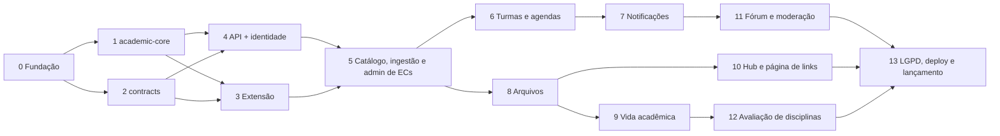

# Roadmap da v2

A v2 é construída de dentro para fora. Primeiro vêm as regras puras e os contratos, depois a extensão que alimenta o catálogo, depois a API e, por fim, cada funcionalidade de ponta a ponta (API + web). Cada fase termina com tudo verde (typecheck, lint, testes, build) e mesclada em `develop`.

## Como trabalhar uma fase

1. Leia a fase aqui, as seções da modelagem que ela cita e as telas listadas.
2. Crie `feature/<fase>-<assunto>` a partir de `develop` (fases grandes podem ter várias branches).
3. Para regras de domínio, escreva os testes antes. Cada linha de tabela de regras da modelagem vira pelo menos um teste.
4. Implemente, rode `pnpm typecheck`, `pnpm lint` e os testes, e marque as caixas desta página no mesmo PR.
5. Atualize [estado-atual.md](estado-atual.md) ao fechar a fase.

---

## Fase 0 — Fundação

**Objetivo:** monorepo instalável e verde, com ferramentas finais (pnpm, Turborepo, oxlint) e banco de desenvolvimento.

- [x] `pnpm install` gera o `pnpm-lock.yaml`; `pnpm typecheck`, `pnpm lint` e `pnpm build` passam.
- [x] Corrigir `react-hooks/set-state-in-effect` em `apps/web/src/contexts/schedule.tsx`, por exemplo derivando o carregamento num `useEffect` assíncrono com flag de cancelamento, ou trocando por TanStack Query. Corrigido também em `class.tsx` e, com a mudança mínima, em `calendar.tsx`.
- [x] Migrar ESLint → oxlint (D19):
  - Rodar `pnpm dlx @oxlint/migrate apps/web/eslint.config.mjs`.
  - Criar a `.oxlintrc.json` na raiz com os plugins `typescript`, `react`, `nextjs`, `import` e `jsx-a11y`.
  - Ligar `eslint-plugin-react-hooks` como plugin JS e o type-aware com `oxlint-tsgolint`.
  - Remover o ESLint e seus plugins.
  - Usar o Prettier só como formatador, com `prettier --check` no CI.
  - Script `lint` por pacote.
  - Confirmar a compatibilidade do tsgolint (TypeScript 7) com os tsconfig em TS 5.9.
- [x] `docker/compose.dev.yml` com PostgreSQL 17 (porta 5432, volume nomeado) e `.env.example` na raiz da API.
- [x] `main` × `master` (D20): `master` continua como produção.
  - [x] CI em PRs para `develop` e `master`.
  - [x] Apagar `main` no remoto (`git push origin --delete main`) e conferir que o GitHub e o Coolify usam `master`.
- [x] Unificar os bancos IndexedDB do web (`UFCFlowDB` + `ufc-flow-indexeddb`) num só, com migração dos dados existentes.
- [x] Vitest configurado no monorepo (`vitest.workspace` ou config por pacote) e tarefa `test` no `turbo.json`.

**Pronto quando:** CI verde em PR para `develop`; `docker compose -f docker/compose.dev.yml up` sobe o Postgres; nenhum dado local de usuário é perdido na unificação do IndexedDB.

## Fase 1 — `packages/academic-core`

**Objetivo:** todas as regras acadêmicas puras, 100% testadas, usadas depois por web, API e extensão. Modelagem: Catálogo acadêmico (Requisitos como expressão), Turmas e agendas (Agenda), Vida acadêmica (Regras do histórico, Progresso), Fórum (Menções).

- [x] `RequirementExpr` (`subject` | `and` | `or`):
  - Parse do texto do SIGAA (`( ECO0018 E ( SBL0084 OU CEC0022 ) )`) para árvore, respeitando parênteses e precedência.
  - Serialização de volta para texto.
  - Extração dos códigos citados.
  - Avaliação contra um conjunto de disciplinas cumpridas, considerando equivalências.
  - Detecção de ciclos num conjunto de disciplinas.
- [x] Termo letivo: parse e comparação de `"2026.1"`, próximo e anterior.
- [x] Conflito de horário entre slots (`weekday`, `start_time`, `end_time`). Portar e substituir `apps/web/src/utils/check-time-conflict`.
- [x] Regras do agregado de agenda: no máximo uma turma por disciplina e nenhum conflito.
- [x] Regras do histórico (tabela "Regras do histórico"):
  - Uma tentativa em aberto por disciplina.
  - Fechamento de `CURSANDO`.
  - Nova tentativa só depois de `REPROVADO`, `TRANCADA` ou `SUPRIMIDA`, em semestre posterior.
  - `APROVEITADA` lançada direto.
  - Faixa de nota por situação (D25: 0 a 10 com duas casas, sem mínimo ou máximo por situação).
- [x] Cálculo de progresso de integralização: obrigatórias, optativas mais livres com teto, cada vertente (horas e componentes), complementares por categoria com teto, extensão e total.
- [x] Disciplinas liberadas para cursar, a partir do histórico e da EC.
- [x] Extração de menções `@([A-Z]{2,5}\d{3,5})`.
- [x] Normalização de busca (sem acento, minúsculas), compartilhada com o web.

**Pronto quando:** o pacote tem cobertura de pelo menos 90%, não depende de framework nem de I/O, e o web já usa o conflito de horário daqui.

## Fase 2 — `packages/contracts`

**Objetivo:** os schemas Zod que web, API e extensão compartilham. Modelagem: Importação e edição de grades, Hub do curso, Página de links, Monorepo e arquitetura (Swagger).

- [x] Enums: naturezas, tipos de vertente, `record_status`, papéis, status de EC, tipos de post e de link, temas da página de links.
- [x] `CurriculumImportV1`: curso (`sigaaId`, nome), EC (período, cidade, cargas), disciplinas com `RequirementExpr`, vertentes com chaves locais e regras da EC. Versionado por `schemaVersion: 1`.
- [x] Problem Details (`type`, `title`, `status`, `detail`, `code`) e paginação por cursor.
- [x] União discriminada dos posts do hub por `type` (tabela de `attributes`).
- [x] Tokens dos temas da página de links (CIANO, LARANJA, VERDE, VIOLETA, BRANCO, ESCURO), com contraste AA verificado em teste. Três destaques mudaram para passar (D31).
- [x] Converter para JSON Schema com `z.toJSONSchema` (para o Swagger) e testar um exemplo válido e um inválido de cada schema.

**Pronto quando:** um JSON de exemplo de EC real passa no `CurriculumImportV1` e fica versionado como fixture em `packages/contracts/fixtures/`. A EC é a Eng. de Computação 2006.2, porque a 2025.1 não existe (D33).

## Fase 3 — Extensão (`apps/extension`)

**Objetivo:** substituir a extensão atual por uma que lê requisitos como expressão, gera `CurriculumImportV1` e envia ao Flow. Modelagem: Importação e edição de grades (Fluxo). Telas: `Ext-*` (9).

- [x] Migrar a **cópia de trabalho** de `C:\Users\furtu\www\sigaa-classes-scraping` (inclui arquivos não commitados) para `apps/extension`, em Plasmo, dentro do workspace pnpm.
- [x] Trocar o parser de requisitos pelo do `academic-core`. Corrige o bug que transforma `OU` em `E`. Cobrir com testes usando HTML real salvo do SIGAA (`example.html` do repositório antigo) como fixture. Cobre 11 ECs reais com ênfases, grupos, internatos e componentes anuais.
- [x] Gerar `CurriculumImportV1` validado com `packages/contracts` antes de oferecer envio ou download.
- [x] UI nova conforme as telas:
  - Popup fora do SIGAA, com login para moderadores e estado de estrutura detectada (claro e escuro).
  - Botão flutuante na página do SIGAA.
  - Painel com grade, vertentes, regras e revisão.
  - Os modais de envio concluído e pendente (`Ext-Envio-*`) foram para a fase 5, junto com o envio.
- [x] Código do curso no SIGAA (D34): captura do curso selecionado na tela de busca, reconhecimento pelo cabeçalho (`matchSigaaCourse`) e escolha manual, com o catálogo da lista pública embutido até a fase 5.
- [x] Telas de login e envio atrás da flag `PLASMO_PUBLIC_FLOW_SYNC`, desligada (D41). A ligação com a API foi para as fases 4 (login) e 5 (envio).

**Pronto quando:** a extensão extrai uma EC real do SIGAA e o JSON passa no schema, com as expressões `OU` preservadas. A 2025.1 de Eng. de Computação não existe (D33); a conferência foi feita com as 11 ECs salvas e com o fluxo completo simulado (tela de busca, lupa, estrutura).

## Fase 4 — API e identidade (`apps/api`)

**Objetivo:** esqueleto NestJS completo e o módulo `identity`. Modelagem: Monorepo e arquitetura, Usuários papéis e permissões.

- [x] NestJS com a estrutura hexagonal por módulo, `shared/` (Result, DomainError, Clock, IdGenerator, paginação, guards) e `database/` (cliente Drizzle, migrations com `drizzle-kit`).
- [x] Swagger em `/docs`:
  - Um documento por versão (`/v1`).
  - Bearer auth.
  - Problem Details referenciado em todas as rotas.
  - Teste de CI que falha se uma operação não tiver resumo e respostas.
  - `openapi.json` versionado.
  - Basic Auth ou `SWAGGER_ENABLED=false` em produção.
- [x] Tabelas de identidade: `users`, `user_roles`, `course_moderators`, `moderator_requests`, `sessions`, `password_reset_tokens`, `user_preferences`, `user_consents` e `audit_logs`.
- [x] Cadastro com aceite de termos, login, refresh com rotação e revogação por família, logout, `GET /me`. Senhas com argon2id e limite de tentativas com `@nestjs/throttler`.
- [x] Recuperação de senha manual: o admin gera um link de uso único válido por 24 h.
- [x] Solicitação de moderação, com aprovação e rejeição pelo admin.
- [x] `AccessPolicy` com todas as linhas da Matriz de permissões, testadas sem banco.
- [x] Login da extensão: `POST /v1/auth/sign-in` com Bearer guardado no `chrome.storage`, ligando a tela que já existe atrás da flag (D41).
- [x] Seed do primeiro admin por comando (`pnpm --filter @ufc-flow/api seed:admin`).
- [x] Web como BFF: tokens em cookies httpOnly, chamadas à API feitas no servidor, telas `Main` e `Mobile-Entrar`, menu do usuário no header.
- [x] Testes: unitários no domínio, casos de uso com repositórios em memória, integração Drizzle com Testcontainers e e2e com supertest.

**Pronto quando:** dá para criar conta, entrar, renovar a sessão e sair pelo web e pelo Swagger, e um admin aprova um pedido de moderação.

## Fase 5 — Catálogo, ingestão e admin de ECs

**Entregue em 4 PRs:** 5.1 API do catálogo e da ingestão, 5.2 extensão, 5.3 web `/admin` e 5.4 web público lendo a API.

**Objetivo:** o catálogo sai do `courses.ts` e vai para o banco, com a área administrativa no lugar do course-maker. Modelagem: Catálogo acadêmico, Importação e edição de grades. Telas: `Admin-EC`, `Mobile-Admin-EC`, `Mobile-Admin-EC-Editar`, `Ext-Envio-*`.

- [x] Catálogo `sigaa_courses` (D34; API no PR 5.1, extensão no 5.2, D61): tarefa agendada que lê a lista pública de cursos do SIGAA (windows-1252, sem login), com execução manual pelo admin; criar curso no Flow é escolher deste catálogo. A extensão passa a usar `GET` do catálogo no lugar do JSON embutido.
- [x] Tabelas do catálogo: `campuses` e `courses` (já criadas na fase 4, D47, faltando a FK para `sigaa_courses`), `curricula`, `subjects`, `curriculum_subjects`, os derivados `*_requirements`, `branches`, `curriculum_subject_branches`, `subject_equivalences` e `subject_equivalence_codes`.
- [x] Agregado `Curriculum` com o ciclo DRAFT → PUBLISHED e **todas** as linhas da tabela "Ciclo de vida e edição" como testes. Auditoria em `audit_logs`.
- [x] `is_current` manual, uma por curso, trocada numa transação.
- [x] `POST /ingestion/curriculum-imports`:
  - Validação pelo schema e JSON bruto guardado.
  - Curso localizado por `sigaa_id` e conferido contra a matriz e a unidade do arquivo; se não existir, a importação fica pendente.
  - Disciplinas reaproveitadas, e divergências viram conflitos.
  - Diff ao reimportar.
  - Checagem de publicação: natureza, vertentes, ciclos e códigos.
- [x] Endpoints públicos de leitura do catálogo para o web, com cache.
- [x] Extensão: envio para `POST /ingestion/curriculum-imports` (ligar a flag `PLASMO_PUBLIC_FLOW_SYNC`), modais `Ext-Envio-Concluido` e `Ext-Envio-Pendente`, envios recentes no popup e aviso de nome diferente do catálogo do Flow na aba Revisar.
- [x] Seed: converter os 6 cursos e 9 ECs de `apps/web/src/data/courses.ts` em `CurriculumImportV1` e passar pelo mesmo pipeline. Os requisitos entram como `E` de todos os códigos e ficam marcados para reimportação.
- [x] Web `/admin` (telas `Admin-EC`, `Mobile-Admin-EC` e `Mobile-Admin-EC-Editar`, D63):
  - Cursos.
  - Estruturas, com o editor da EC: tabela por período, painel lateral da disciplina e editor visual de expressão E/OU.
  - Vertentes e vínculo em lote.
  - Diferenças da importação, exportação em JSON, revisar e publicar.
- [x] Web público passa a ler o catálogo da API (D65), com o IndexedDB só como cache offline. URLs e slugs atuais não mudam.

**Pronto quando:** a grade pública é servida pela API com as mesmas URLs, e um moderador importa pela extensão, revisa e publica uma EC.

## Fase 6 — Turmas e agendas

**Objetivo:** turmas coletadas pelo backend com IDs estáveis, agendas sincronizadas para logados e importação das agendas locais. Em três PRs (D67): 6.1 turmas, 6.2 agendas na API e 6.3 agenda no web. Modelagem: Turmas e agendas. Telas: `Agenda-Notificacoes` (agenda), `Mobile-Agenda`, `Importar-Agendas`, `Mobile-Importar-Agendas`.

- [x] Tabelas: `academic_terms`, `instructors`, `class_sections`, `class_section_slots`, `class_section_instructors`, `class_section_offers` (com `reserved_seats` por curso) e `scrape_runs`.
- [x] Job de coleta com `@nestjs/schedule`:
  - A cada 6 h, para cada curso ativo no semestre vigente e nos que começam nos próximos 45 dias (D68).
  - Cursos em sequência, com pausa entre eles.
  - Atualização pela chave natural, `fingerprint`, e `removed_at` para turmas que somem.
  - Disparo manual para moderadores e admins.
- [x] Portar o scraping de `apps/web/src/app/api/scrapping` para o módulo `classes`. O route handler do web passa a chamar a API, com o SIGAA como reserva até a fase 13 (D69).
- [x] `GET /terms/:term/courses/:course/sections`. Semestre vigente vem de `academic_terms` (sai do `.env`), com a tela "Semestres e turmas" no admin (`/admin/semestres`).
- [x] `schedules` (com `curriculum_id`, D71) e `schedule_items`; agregado `Schedule` usando o `academic-core` (D72).
- [x] API das agendas: `GET`, `PUT` e `DELETE` em `/me/schedules` e `POST /me/schedules/import`.
- [x] Web logado (D73):
  - O servidor é a fonte da verdade, com atualização otimista e reversão quando a API recusa.
  - Avisos de "horário mudou" (`slots_fingerprint`) e de "turma não ofertada" (`removed_at`), na barra lateral e no calendário.
- [x] Importação no primeiro login, com `POST /me/schedules/import` (telas `Importar-Agendas` e `Mobile-Importar-Agendas`):
  - O UUID local vira o id da agenda, então reenviar não duplica.
  - A resposta lista os itens não encontrados.
  - O diálogo pede confirmação do curso quando a EC antiga existe em mais de um curso.
- [x] Anônimo continua 100% local.
- [x] Redesenho da página da agenda conforme `Agenda-Notificacoes` e `Mobile-Agenda` (resumo "Na agenda", calendário da semana, aviso compacto e barra do celular), feito no PR 7.3. A lista de disciplinas do curso continua abaixo do resumo, porque é por ela que as turmas entram na agenda e o mockup não mostra outro caminho.

**Pronto quando:** uma agenda criada anônima é importada no login sem duplicar, e uma mudança de horário no SIGAA aparece como aviso na agenda.

## Fase 7 — Notificações

**Objetivo:** sino com contador e a infraestrutura de eventos, que as fases seguintes reutilizam. Em três PRs: 7.1 notificações na API, 7.2 sino e painel no web e 7.3 o redesenho da página da agenda (pendência da fase 6). Modelagem: Notificações. Telas: `Agenda-Notificacoes` (painel), `Mobile-Notificacoes`.

- [x] `notifications`; eventos de domínio publicados depois do commit com `@nestjs/event-emitter`. `hub_reads` foi para a fase 10 (D74).
- [x] Agrupamento por `group_key` com upsert. Nunca notificar a própria ação nem conteúdo que o usuário não pode ver.
- [x] Preferências: `notifications.muted` em `user_preferences`, com `GET`/`PUT /me/notification-preferences`.
- [x] Endpoints: lista paginada, contagem de não lidas, marcar como lidas.
- [x] Polling de 60 s no web (o contador do sino; o fórum vai usar o mesmo intervalo).
- [x] Retenção de 90 dias por job diário.
- [x] Tipos desta fase: `SCHEDULE_SECTION_CHANGED`, `SCHEDULE_SECTION_REMOVED`, `SCRAPE_FAILED`, `IMPORT_PENDING`, `MODERATOR_REQUEST_CREATED` e `MODERATOR_REQUEST_REVIEWED`. Os do fórum entram na fase 11.
- [x] Redesenho da página da agenda (pendência da fase 6), PR 7.3.
- [x] Web: sino com contador (cabeçalho, agenda e admin), painel no desktop, página `/notificacoes` (Hoje, Ontem e Antes, filtro de não lidas) e preferências por categoria, conforme o papel.

## Fase 8 — Arquivos

**Objetivo:** upload seguro na VM atrás da porta `FileStorage`. Em dois PRs: 8.1 na API e 8.2 no web (rotas do BFF e foto de perfil). Modelagem: Arquivos e imagens.

- [x] Tabela `files`; `POST /files` multipart com finalidade, validação de tipo pelos bytes e limite por finalidade (D75).
- [x] Reprocessamento com sharp: WebP, no máximo 2000 px e sem EXIF.
- [x] Ciclo PENDING → ATTACHED; job diário de limpeza, inclusive de arquivos órfãos.
- [x] `GET /files/:id`: públicos com cache longo; privados só para o dono.
- [x] Foto de perfil como primeiro uso: `PUT`/`DELETE /me/avatar` e `avatarFileId` no `Me`.
- [ ] Volume Docker montado em `/data/uploads`: a API já lê `UPLOADS_DIR`; o volume entra com o deploy, na fase 13.
- [x] Web: rotas do BFF para enviar (`/api/files`) e entregar (`/arquivos/{id}`) arquivos e a troca da foto no menu da conta (PR 8.2).

## Fase 9 — Vida acadêmica do aluno

**Objetivo:** matrícula, histórico, horas complementares e progresso. Modelagem: Vida acadêmica do aluno. Telas: `Minha-Area`, `Historico`, `Mobile-Minha-Area`, `Mobile-Historico`, `Mobile-Historico-Registro`, `Mobile-Navegacao`.

- [x] `student_enrollments`, `student_subject_records`, `activity_categories` e `student_activity_records`.
- [x] Agregado `AcademicRecord` usando as regras do `academic-core`.
- [x] Progresso com a exigência de complementares lida do componente `COMPLEMENTARY_ACTIVITY` e o total da D27 revisto (D40); ênfases exigidas e permitidas e máximos de grupo (D37).
- [x] Troca de EC no mesmo curso, auditada, e transferência interna, que cria nova matrícula.
- [x] Lançamento de atividades com certificado (fase 8) e categorias por EC, cadastradas por moderadores (PRs 9.1 e 9.3).
- [x] Minha área (PR 9.2), com as telas `Minha-Area`, `Historico`, `Mobile-Minha-Area`, `Mobile-Historico`, `Mobile-Historico-Registro` e `Mobile-Navegacao`:
  - Progresso por categoria e por vertente.
  - Disciplinas cursando e liberadas para cursar.
  - Histórico filtrável por situação, com registro de disciplina em painel ou folha.
  - Aviso de "fechar situação" no fim do semestre.

## Fase 10 — Hub do curso e página de links

**Objetivo:** posts do hub e a página pública de links no estilo Linktree. Modelagem: Hub do curso, Página de links. Telas: `Hub`, `Mobile-Hub`, `Links-Pagina`, `Links-Editor`, `Mobile-Links`, `Mobile-Links-Editor`.

- [x] `posts` e `post_images`, com validação por tipo (união do `contracts`). Corpo em Markdown com lista restrita de elementos.
- [x] Feed com fixados primeiro e filtros por tipo, "próximos" e prazos encerrados. Posts institucionais (`course_id` nulo) só para admin.
- [x] `hub_reads` (vinda da fase 7, D74) e o badge de novidades.
- [x] Página de links:
  - Seis tabelas (`course_link_pages`, `course_link_sections`, `course_links`, `course_social_links`, `link_clicks_daily`, `link_page_views_daily`).
  - Leitura pública em `GET /l/:slug`, com cache de 60 s.
  - Redirecionamento contado em `GET /l/:slug/go/:linkId`.
  - Ordenação em lote, agendamento de visibilidade, destaque único, selo "Novo".
  - QR code gerado no front.
- [x] Editor com pré-visualização ao vivo, temas prontos, estilo e formato de botão, fonte do título e "links mais clicados".
- [x] Redesenhar `Links-Pagina`, `Links-Editor`, `Mobile-Links` e `Mobile-Links-Editor` junto com a implementação, com as cores de `LINK_PAGE_THEMES` (D31) em vez das do mockup.

## Fase 11 — Fórum e moderação

**Objetivo:** fórum estilo X por curso, com menções e moderação. Modelagem: Fórum do curso. Telas: `Forum`, `Mobile-Forum`, `Mobile-Forum-Escrever`, `Forum-Mobile`, `Admin-Moderacao`, `Mobile-Admin-Moderacao`.

- [x] `messages`, `message_likes`, `message_subject_mentions`, `message_reports`, `moderation_actions` e `user_course_restrictions`.
- [x] Timeline de mensagens raiz com cursor `(created_at, id)`, conversa com a cadeia até a raiz e contadores atualizados na mesma transação.
- [x] "N novas mensagens" por polling, edição em até 15 min e regras de exclusão da própria mensagem.
- [x] Popover de `@`:
  - Busca em `GET /courses/:course/subjects/search` com trigram e debounce de 150 ms.
  - Token `@CÓDIGO` gravado no texto.
  - Chips clicáveis na leitura.
  - Aba "Discussões" na disciplina.
- [x] Denúncias:
  - Uma por pessoa, com motivo.
  - Ocultação automática com 3 denúncias.
  - Ações de moderação com motivo.
  - MUTE e BAN com prazo.
  - Limite de envio por usuário.
- [x] Admin › Moderação com três abas: denúncias, pedidos de moderação e restrições ativas.
- [x] Notificações do fórum: `FORUM_REPLY`, `FORUM_THREAD_REPLY`, `FORUM_LIKES`, `MESSAGE_MODERATED` e `USER_RESTRICTED`.

## Fase 12 — Avaliação de disciplinas

**Objetivo:** notas de 1 a 5 por critério, anônimas, exibidas a partir de 5 respostas. Modelagem: Avaliação de disciplinas. Telas: `Disciplina-Avaliacao`, `Mobile-Disciplina`.

- [x] `evaluation_criteria`, `subject_evaluations` e `subject_evaluation_scores`. Critérios geridos pelo admin.
- [x] Só avalia quem tem `APROVADO` ou `REPROVADO` na disciplina; uma avaliação por pessoa, editável.
- [x] Agregados na leitura (média, contagem, distribuição) só com n ≥ 5; `user_id` nunca exposto.
- [x] Flag `EVALUATION_REQUIRE_INSTITUTIONAL_EMAIL`, desligada.

## Fase 13 — LGPD, deploy e lançamento

**Objetivo:** pôr a v2 no ar com segurança. Modelagem: Usuários (LGPD), Lacunas e riscos.

- [x] Texto final dos Termos de uso e da Política de privacidade, com versão nova e novo aceite de quem aceitou a `0.1` (D46). `GET /me/export` e exclusão de conta com as regras de apagar e anonimizar da modelagem. Feito nos PRs 13.1 (API, D98) e 13.2 (web, D99), com Admin › Usuários (suspensão e descarte de avaliações).
- [x] Coolify com três containers (`web`, `api`, `postgres`), volume de uploads e variáveis de ambiente documentadas. PR 13.3 (D100): `docker/compose.prod.yml`, `apps/api/Dockerfile` e [deploy.md](deploy.md); domínios configurados na VM, fora do repositório.
- [x] Revisar os riscos em aberto: backup, identidade não verificada, dependência do HTML do SIGAA. Backup segue em aberto por decisão do usuário; identidade não verificada tem suspensão e descarte de avaliações (D98, D99); o SIGAA tem o aviso `SCRAPE_FAILED`.
- [ ] Release `release/v2.0.0` → `master` e `develop`, tag `v2.0.0`. Atualizar versão, README e documentos de GCS.
